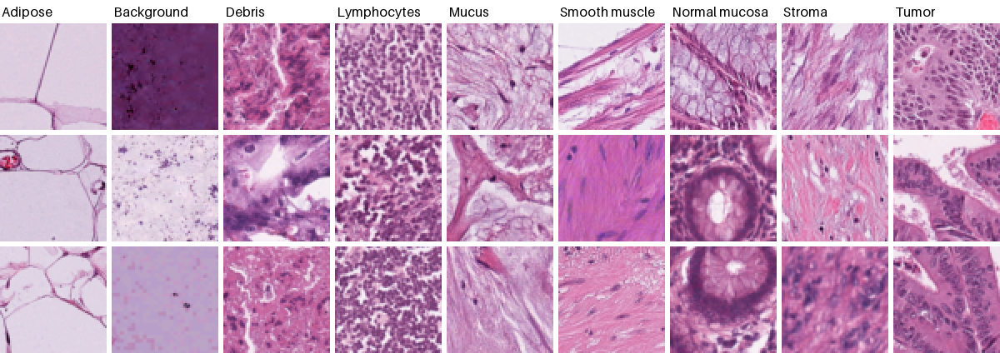
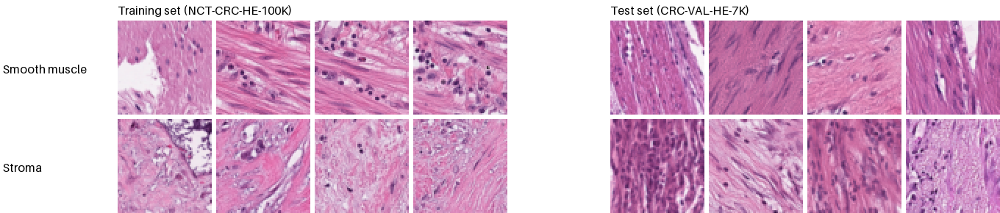
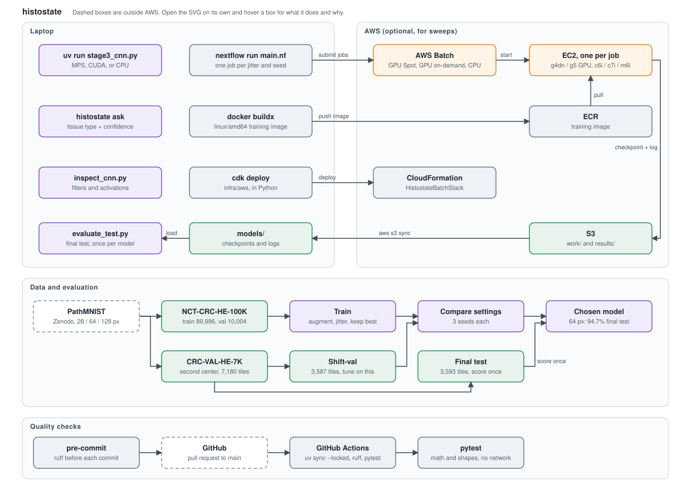
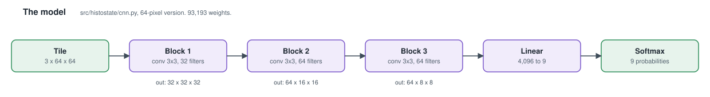
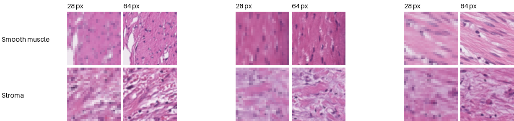
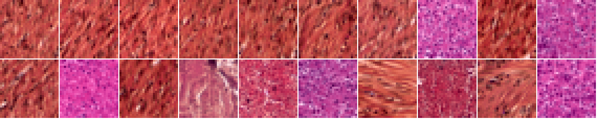
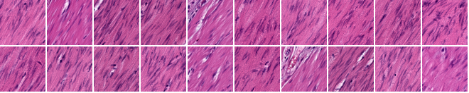

# histostate

Name the tissue type in a colorectal H&E (hematoxylin and eosin) image with a small CNN
(convolutional neural network) built and trained from scratch in PyTorch. No pretrained weights,
no trainer libraries: the point is to learn every piece, from gradient descent up.



*The nine tissue classes the model tells apart, three PathMNIST tiles each at 64x64 pixels.*

```bash
uv run histostate ask tile.png
```

[docs/walkthrough.md](docs/walkthrough.md) tells the story stage by stage: what each step
taught, the numbers it produced, and what went wrong. [docs/software.md](docs/software.md) lists
every tool used, what it does, and why it was picked over the alternatives.

A learning project, not a medical device. Not for clinical or diagnostic use.

## Why I built this

My background is in biology, not machine learning. My first plan for this repo put a small
classifier on top of a pretrained pathology foundation model (Owkin's Phikon-v2). That would have
worked, but the frozen model does the hard part, and I would have learned little about how a model
is trained, tuned, or evaluated.

So I changed the goal: build a tissue classifier myself, from the bottom up, and understand every
piece. Each stage adds one idea, from gradient descent on two weights through logistic regression,
an MLP, and a CNN. The part that taught me the most came after the model worked: finding out that
a 97% validation score said little about slides from another clinic, and fixing that honestly. I
kept the domain in histology because I know the tissue, which made it easier to tell when the
model was right for the wrong reasons.

I worked through it with Claude Code as a tutor. The rule in [`CLAUDE.md`](CLAUDE.md) was that
every step got explained in plain language before any code changed, and every result got
interpreted after it ran. I decided what to try next and checked the results; Claude explained the
concepts and wrote much of the code.

It is also a portfolio project:

- **PyTorch from scratch:** hand-written softmax and cross-entropy, and a training loop with
  gradient clipping, cosine learning-rate decay, and augmentation. No pretrained weights or
  trainer libraries.
- **Evaluation:** a shifted validation set from a different clinical center, several seeds before
  trusting a gap, a final test scored once per model, and activation inspection that caught the
  model using stain color as a shortcut.
- **AWS:** CDK in Python, AWS Batch with GPU and CPU queues, ECR, S3, and Nextflow.
- **Python and CI:** uv, ruff, pytest, pre-commit, and GitHub Actions.

## Data

[PathMNIST](https://medmnist.com/) from MedMNIST: 107,180 colorectal H&E tiles at 28x28 pixels
(also published at 64x64 and 128x128), 9 tissue classes. It downloads on first use.

The official test set (CRC-VAL-HE-7K) comes from a different clinical center than train and
validation (NCT-CRC-HE-100K), and its staining looks different:



*Same two tissues, two clinical centers. A model can score 97% on tiles like the left and much
lower on tiles like the right.*

`src/histostate/splits.py` cuts the test set into two stratified halves: shifted validation
(shift-val), used for tuning, and final test, scored once per model choice.

## How it fits together



Every stage runs on a laptop. For sweeps (several settings times several seeds), Nextflow sends
each training run to AWS Batch as its own job. Batch scales the instances to zero when the queue
is empty, so idle time costs nothing. One 64-pixel run (60 epochs) took 16 to 24 minutes on a T4
GPU. GitHub shows the diagram as a plain image. Opened in a browser,
[`docs/architecture.svg`](docs/architecture.svg) is interactive: hover a box for what it does and
why, and click it for its docs or source.



93,193 weights in `src/histostate/cnn.py`. The 28-pixel version stops after two blocks. Like the
diagram above, [`docs/model.svg`](docs/model.svg) is interactive in a browser.

### AWS services

AWS is optional: it ran the seed sweeps in parallel. The full list of tools, including the ones
passed over, is in [`docs/software.md`](docs/software.md).

| Service | Job here | Why this one |
|---|---|---|
| **AWS Batch** | Three job queues: GPU Spot, GPU on-demand, CPU Spot | Starts an instance per job and scales to zero when idle. No cluster to run. |
| **EC2** | g4dn.xlarge (NVIDIA T4) and g5.xlarge (A10G) for GPU jobs; c6i, c7i, m6i for CPU | The smallest GPU instances. A T4 trains a 64-pixel epoch in about 10 s. Spot reclaimed both GPU instances mid-run once, so the 64-pixel runs used on-demand. |
| **ECR** | Stores the training image | Batch pulls it with the instance's IAM (Identity and Access Management) role, so no registry login lives on the instance. |
| **S3** | Nextflow's working files and the checkpoints and logs | Both the jobs and the laptop read and write it. `work/` expires after 30 days. |
| **CloudFormation / CDK** | Every resource above | One CDK app in Python with tests, deployed with one command. |

Not AWS, and why: PyTorch and MedMNIST (the model and the data), Nextflow (fans a sweep out into
Batch jobs and retries reclaimed Spot jobs), Docker (an open standard Batch consumes), uv, ruff,
and pytest (language tooling), GitHub Actions (the repo is on GitHub).

## Results

Each stage is one script in `scripts/`, building on the last.

| Stage | Script | Validation accuracy |
|---|---|---|
| Warm-up: fit a line with hand-written gradient descent | `warmup_fit_line.py` | n/a |
| 1: logistic regression on pixels | `stage1_logreg.py` | about 47% |
| 2: MLP (multilayer perceptron) | `stage2_mlp.py` | about 66% |
| 3: CNN at 28 pixels, 2 conv blocks, 47,625 weights | `stage3_cnn.py --size 28` | 95.1% |
| 3: CNN at 64 pixels, 3 conv blocks, 93,193 weights | `stage3_cnn.py` | 97.8% |

Stage 3 trains with SGD (stochastic gradient descent), gradient clipping, cosine learning-rate
decay, flip and rotate augmentation, and color jitter (0.3). It keeps the epoch with the best
validation accuracy.

At 28 pixels, a third conv block adds about 1 point on validation and nothing on shift-val; going
to 64 pixels adds about 3 points there. Fiber shape is what separates stroma from smooth muscle,
and most of it is gone at 28 pixels:



`scripts/inspect_cnn.py` shows what each model learned. The 28-pixel model's best stroma/muscle
feature fired hardest on darkly stained tiles, a shortcut that breaks when staining changes:



The 64-pixel model's best feature fires on long, parallel, spindle-shaped nuclei, which is what
smooth muscle looks like:



Final model (64 pixels, seed 0): 94.0% on shift-val and 94.7% on final test
(`scripts/evaluate_test.py`, 2026-10-22). Stroma (75% recall) and smooth muscle (83%) are still
its main confusion. The 28-pixel model scored 91.4% on the same final test half, with stroma at
63% and muscle at 76%.

## Setup

Requires [uv](https://docs.astral.sh/uv/).

```bash
uv sync
uv run pytest
uv run python scripts/stage3_cnn.py --save models/stage3_cnn.pt
```

Picks a CUDA (NVIDIA) GPU, then Apple Silicon (MPS, Metal Performance Shaders), then CPU; override
with `--device`. A laptop is enough for every stage. `scripts/readme_images.py` redraws the tile
figures above, and `scripts/make_diagrams.py` redraws the two diagrams.

## Train on AWS (optional)

Not needed to follow along, and it bills your AWS account. `main.nf` runs Stage 3 training on AWS
Batch, one job per jitter and seed pair, on GPU instances (`-profile aws,gpu`) or CPU instances
(`-profile aws,cpu`). Requires Nextflow >= 26.04, AWS credentials, the stack in `infra/aws`
deployed, and the image pushed to ECR (Elastic Container Registry); `infra/aws/README.md` covers
both. Copy `.env.example` to `.env` and fill it in.

```bash
set -a; source .env; set +a
nextflow run main.nf -profile aws,gpu --jitters 0.3,0.5 --seeds 1,2
```

Checkpoints and logs land in `$AWS_S3_OUTDIR/stage3/`; `pipeline_info/trace.tsv` there records
time and peak memory per run.

## Layout

```
src/histostate/     model, augmentation, splits, and the ask command
tests/              pytest tests, no network by default
scripts/            one training or evaluation script per stage, plus figures
app/                Gradio demo page around the ask command
infra/aws/          CDK stack for AWS Batch
docs/               the walkthrough, the software list, and README images
```

## Data license and citation

PathMNIST is licensed CC BY 4.0. If you use it, cite MedMNIST and the source dataset:

- Yang, J., et al. "MedMNIST v2: A large-scale lightweight benchmark for 2D and 3D biomedical
  image classification." Scientific Data, 2023.
- Kather, J. N., et al. "Predicting survival from colorectal cancer histology slides using deep
  learning: A retrospective multicenter study." PLOS Medicine, 2019.

The tile images in `docs/images/` are PathMNIST tiles, shown under the same license. Code is
Apache-2.0 (`LICENSE`).

## Contact

Questions about the project, or contract work: [todd.creasy@pilotbio.io](mailto:todd.creasy@pilotbio.io)
